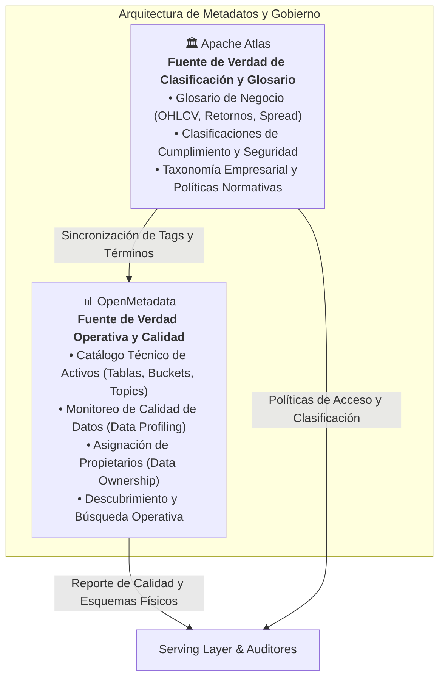

# Delimitación de Responsabilidades: Apache Atlas vs. OpenMetadata

> **Documento de Gobierno de Datos y Cumplimiento Normativo (US-27: Criterio 3)**  
> **Responsable:** Diego (Lead de Gobierno, Speed Layer & Streaming)  
> **Versión:** 1.0.0 — Octubre 2026  
> **Estado:** Aprobado / Referencia Oficial de Arquitectura

---

## 1. Resumen Ejecutivo y Principio de Separación

La plataforma de datos para mercados financieros y criptomonedas implementa una **Arquitectura Lambda clásica** (Batch, Speed, Serving). Para gobernar los datos de forma integral sin solapamientos ni duplicidad de responsabilidades entre herramientas, se establece una **delimitación formal de fuentes de verdad**:

---

## 2. Apache Atlas: Fuente de Verdad para Clasificación y Glosario Empresarial

**Apache Atlas** es la autoridad corporativa exclusiva para la semántica de negocio y la seguridad de la información:

1. **Glosario de Negocio Unificado (*Business Glossary*)**:
   - Centraliza la definición formal de conceptos financieros y matemáticos: *Vela Japonesa (OHLCV)*, *Precio de Cierre*, *Volumen Ponderado (VWAP)*, *Event-Time*, *Retorno Porcentual*, *Watermark*, *Slippage* y *Spread*.
   - Define el *Steward* responsable, fórmulas canónicas y sinónimos para evitar ambigüedades entre los equipos de ingeniería, analistas de negocio y modelos conversacionales (RAG con Qwen 2.5).

2. **Taxonomía y Clasificaciones de Seguridad (*Security & Compliance Classifications*)**:
   - Clasifica las entidades en categorías de gobernanza:
     - `Datos_Publicos_Mercado`: Información transaccional abierta sin restricciones de confidencialidad.
     - `Metadatos_Sensibles`: Credenciales, secretos de conexión, logs de auditoría interna y configuraciones críticas.
     - `Datos_Provisionales_Speed`: Métricas de baja latencia emitidas por streaming (`is_provisional = true`) sujetas a reemplazo por la capa Batch.
     - `Datos_Historicos_Inmutables`: Particiones consolidadas en MinIO protegidas contra modificaciones destructivas.
     - `Datos_Cuarentena_DLQ`: Registros fuera de contrato aislados para análisis forense.
   - Atlas propaga estas etiquetas de clasificación a lo largo de las relaciones de linaje técnico (*tag propagation*).

---

## 3. OpenMetadata: Fuente de Verdad para Catálogo Operativo y Calidad de Datos

**OpenMetadata** es la autoridad operativa para la gestión del día a día del catálogo y la salud de los datos:

1. **Catálogo Técnico y Descubrimiento Operativo**:
   - Ingesta y rastreo (*crawling*) automatizado de esquemas físicos:
     - Buckets y prefijos funcionales de MinIO (`market-lake`, `market-quarantine`, `market-checkpoints`).
     - Topics de Apache Kafka (`market.events`, `market.ohlcv`, `market.metrics`, `market.dlq`).
     - Esquemas y vistas de PostgreSQL (`serving.dim_assets`, `serving.ohlcv_reconciled`, `serving.realtime_metrics`).
   - Búsqueda en lenguaje natural y documentación de campos técnicos.

2. **Calidad de Datos y Perfilado (*Data Profiling & Quality Tests*)**:
   - Evaluación continua de reglas de integridad: tests de no nulidad, unicidad de claves primarias, rangos de precios positivos y frescura temporal.
   - Detección de degradación en la calidad antes de que los datos alcancen los dashboards del frontend.

3. **Asignación de Propietarios y Colaboración (*Data Ownership & Tiering*)**:
   - Mapeo de ingenieros responsables (*Data Owners*) y equipos a cada dataset.
   - Definición del nivel de servicio (*Tier 1: Core Serving*, *Tier 2: Speed Analytics*).

---

## 4. Matriz de Responsabilidades (RACI)

| Dimensión de Gobernanza | Apache Atlas | OpenMetadata | Observaciones |
| :--- | :---: | :---: | :--- |
| **Glosario de Negocio Empresarial** | **A / R** | C / I | Atlas define el glosario; OpenMetadata lo consume por API/webhook. |
| **Clasificación de Seguridad (Sensible, Público, DLQ)** | **A / R** | C / I | Atlas establece el estándar normativo y políticas de etiquetado. |
| **Catálogo Físico (Tablas, Topics, Buckets)** | C / I | **A / R** | OpenMetadata rastrea y versiona los esquemas de bases de datos y brokers. |
| **Pruebas de Calidad de Datos (Profiler/Tests)** | I | **A / R** | OpenMetadata ejecuta pruebas periódicas de completitud y frescura. |
| **Asignación de Propietarios (Data Owners)** | C | **A / R** | OpenMetadata gestiona equipos, roles y responsables técnicos directos. |
| **Auditoría de Cumplimiento Normativo (SOC2/GDPR)** | **A / R** | C | Atlas certifica qué activos manejan metadatos sensibles. |

*Leyenda: **A** = Accountable (Autoridad Máxima), **R** = Responsible (Ejecutor), **C** = Consulted (Consultado), **I** = Informed (Informado).*

---

## 5. Protocolo de Sincronización e Interoperabilidad

Para mantener la coherencia y evitar desalineaciones entre ambos sistemas:
1. **Flujo Unidireccional de Taxonomía**: Las clasificaciones y términos creados en `metadata/atlas_glossary.json` y `metadata/atlas_types_classifications.json` se consideran la única versión oficial (*Source of Truth*).
2. **Importación Automatizada**: El script [`metadata/import_atlas_governance.py`](file:///c:/Users/diego/Documents/basededatozzz/metadata/import_atlas_governance.py) aprovisiona Atlas de forma idempotente vía su REST API v2.
3. **Mapeo a OpenMetadata**: OpenMetadata mapea mediante sus conectores de gobernanza las clasificaciones de Atlas como etiquetas operativas (*Tags/Glossary references*), sin modificarlas localmente.
4. **Independencia de la Arquitectura Lambda**: Ninguno de los dos sistemas interfiere en el flujo de ejecución de Spark Batch, Spark Streaming ni FastAPI; actúan como una capa de observación y gobierno desacoplada.
